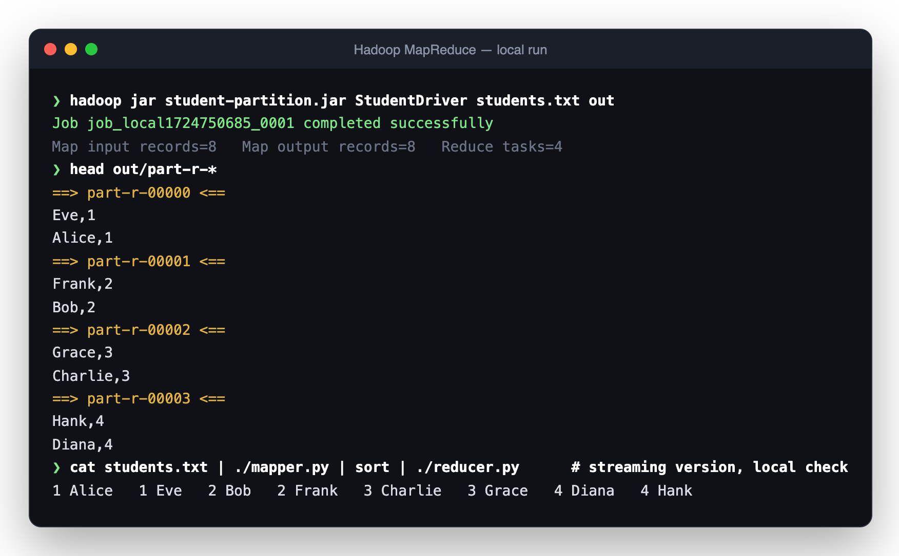
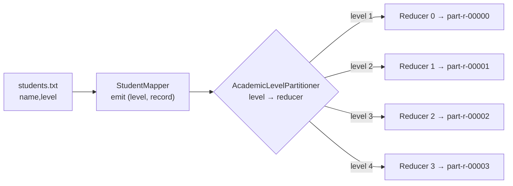

<div align="center">

# Hadoop MapReduce · Student Partitioning

**Route every record to the right reducer. A custom Hadoop `Partitioner` that splits students by academic level into separate output files, in native Java and in Python streaming.**




</div>

---

## Why it matters

By default Hadoop hashes keys to reducers, so you can't predict which output file a record lands in. When downstream teams want **one file per category** (per region, per tier, or here per academic level), you need a custom `Partitioner`. This project shows the pattern end to end on a small, readable dataset.

## How the data flows



## What's inside

| Path | Description |
|---|---|
| `java/StudentMapper.java` | Parses `name,level` and emits `(level, record)` |
| `java/AcademicLevelPartitioner.java` | Custom `Partitioner<IntWritable, Text>` mapping each level to its own reduce task |
| `java/StudentReducer.java` | Writes each level's records to its partition file |
| `java/StudentDriver.java` | Configures the job with 4 reduce tasks and the custom partitioner |
| `python-streaming/` | The same grouping as a Hadoop Streaming `mapper.py` / `reducer.py`, plus sample input and output |

## Run it

**Java (Hadoop local mode)**

```sh
cd java
javac -cp "$(hadoop classpath)" -d classes *.java
jar cf student-partition.jar -C classes .
hadoop jar student-partition.jar StudentDriver ../python-streaming/students.txt out
head out/part-r-*
```

**Python streaming**

```sh
cd python-streaming
hadoop jar $HADOOP_HOME/share/hadoop/tools/lib/hadoop-streaming-*.jar \
  -input students.txt -output out \
  -mapper mapper.py -reducer reducer.py -file mapper.py -file reducer.py

# or check it without Hadoop:
cat students.txt | ./mapper.py | sort | ./reducer.py
```

## About

Built by **Roszhan Raj** for Advanced Database Management Systems at California State University, Fullerton.
